# K-PaaS 기반 개인 지식서재 플랫폼

작품명: 하늘책방
  
> 클라우드 환경에서 기록·지식·관계를 연결하는 MSA 구조의 PKM(Personal Knowledge Management) 서비스

[K-PaaS 서비스 개발 공모 작품 제출작](https://pkm-frontend-zeta.vercel.app): 대회 기간이 종료됨에 따라 서버 중단

 

## 📆 개발 개요

| 항목 | 내용 |
|------|------|
| **개발 기간** | 2025.09.05 ~ 2025.11.01 |
| **개발 환경** | NCP K-PaaS 클러스터 (CPU 2core, 4GB 노드 2대) |
| **참여 팀원** | @downfa11(backend), @minwooggi(backend, frontend), @breakpack (frontend), @leejaejjun(PM) |
| **기술 스택** | Java, Go, Spring MVC, Spring Webflux, Spring Cloud Gateway, MongoDB, Elasticsearch, Yorkie, Redis |

 

## 🏗️ 시스템 아키텍처

**서비스 전체 아키텍처**

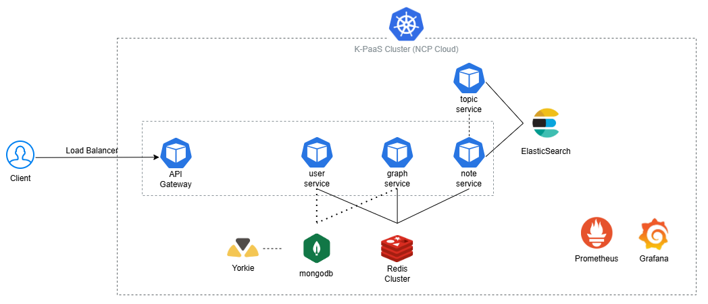

 

> 총 4개의 서비스가 서로 독립적인 배포 및 장애 격리 기능을 갖춤

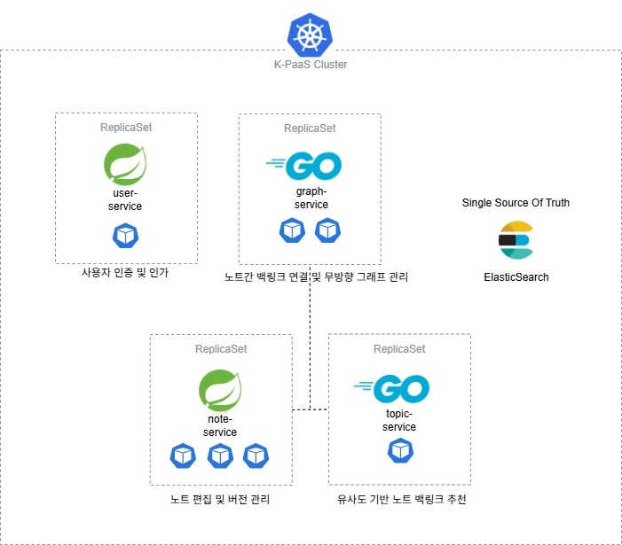

 

각 서비스 간 호출은 HTTP REST 기반이며,  
API Gateway는 `Resilience4j`로 Circuit Breaker, Retry, Fallback 적용

 

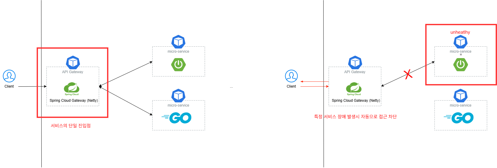

 

## 📚 주요 기능

| 기능 | 설명 | 이미지 |
|------|------|--------|
| **지식 시각화 (Graph)** | `D3.js` 기반 지식 네트워크 시각화 | 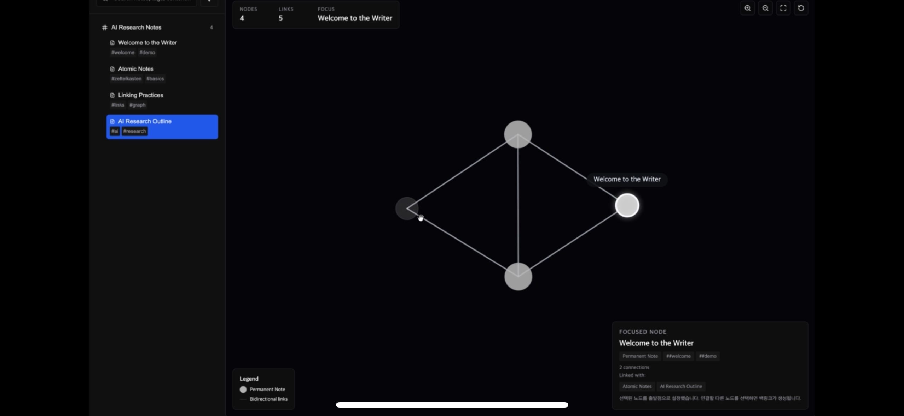 |
| **상향식 글쓰기 구조 변환** | 방법론간 구조 변환 알고리즘 | 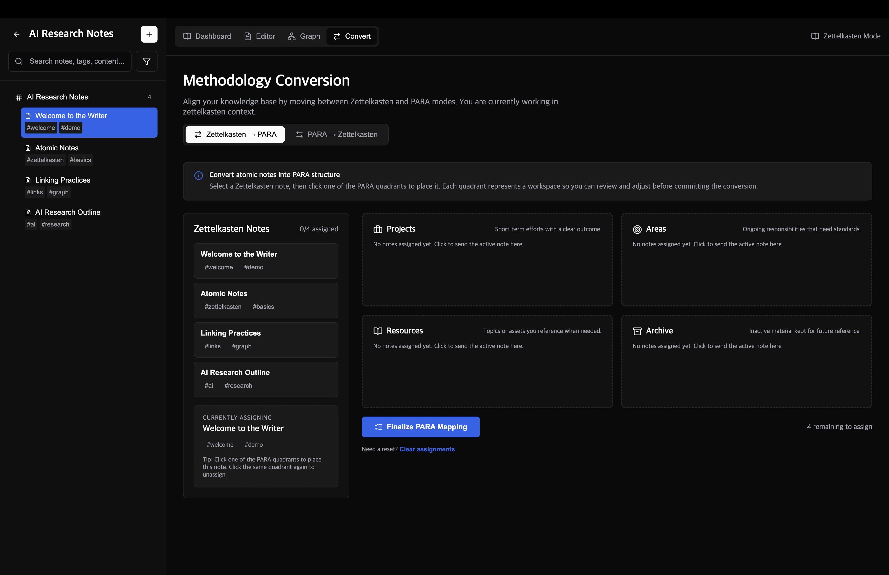 |
| **실시간 문서 협업** | Yorkie 기반 실시간 동시 협업과 RBAC 인가 | 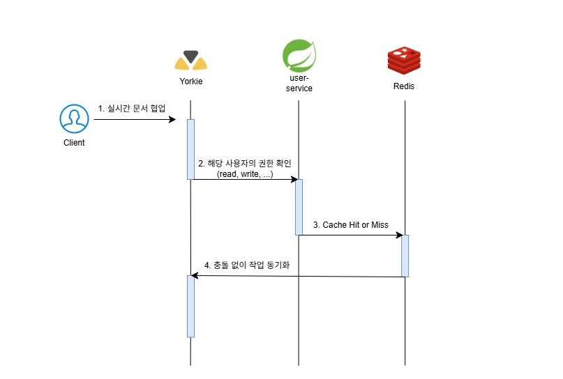 |

 

## 🔄 CI/CD 파이프라인

> NCP source Build, Registry, Deploy를 활용한 자동화된 배포 파이프라인 구조

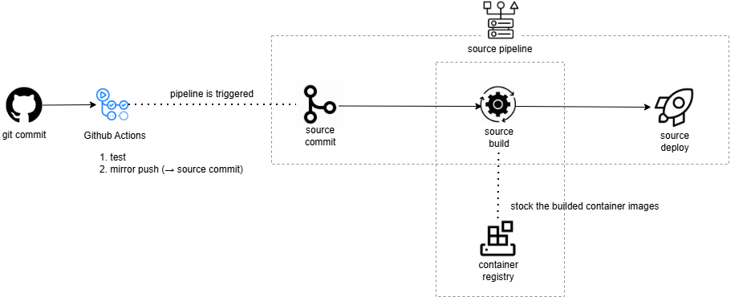 

- GitHub Actions → K-PaaS API 연동  
- 브랜치 단위 Build → Container Registry Push → Deploy 자동화  
- 장애 발생 시 Rollback 및 재배포 자동 수행

 

## 🧠 데이터 및 메타 구조

> 노트 간 연결과 태그, 문맥, 유사도 기반 탐색 구조

 

**데이터 테이블 관리**

- ElasticSearch + MongoDB 하이브리드 조회 

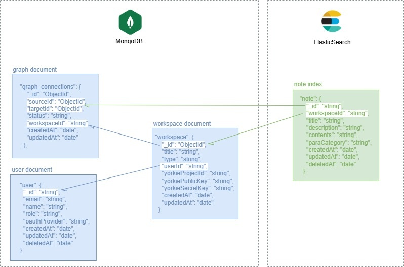

 

## 📊 모니터링 & 운영

모니터링 설계

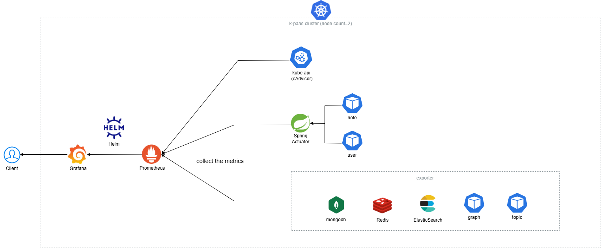

 

Grafana Dashboard

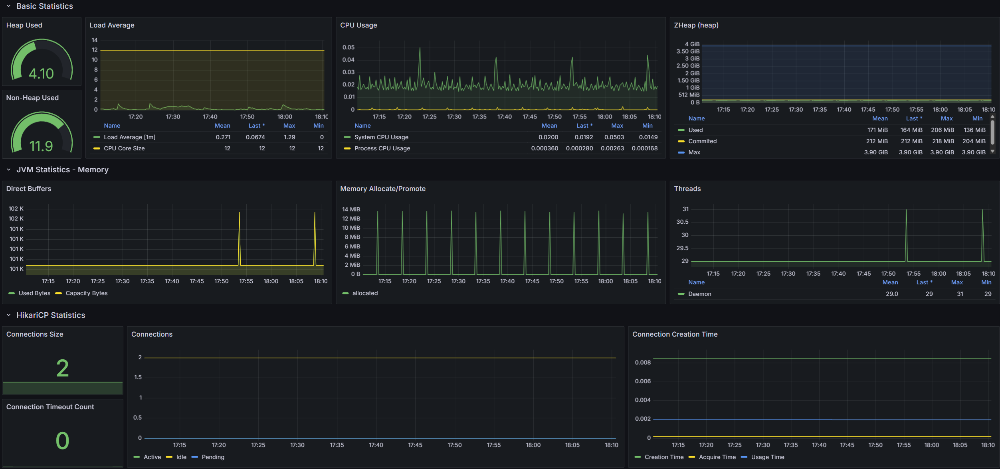

 

## 시연 스크린샷

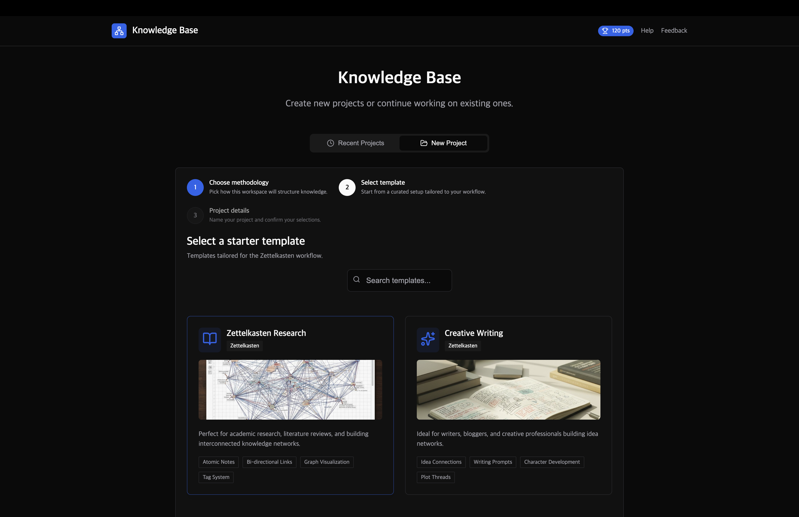

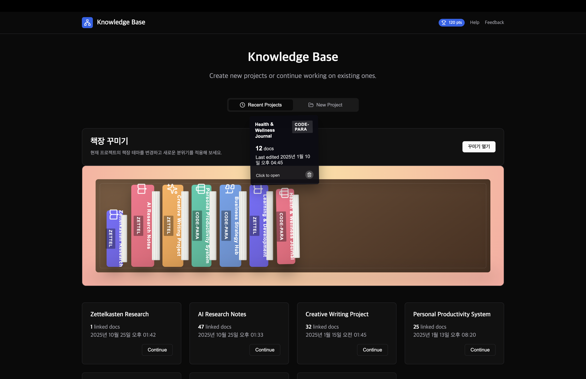

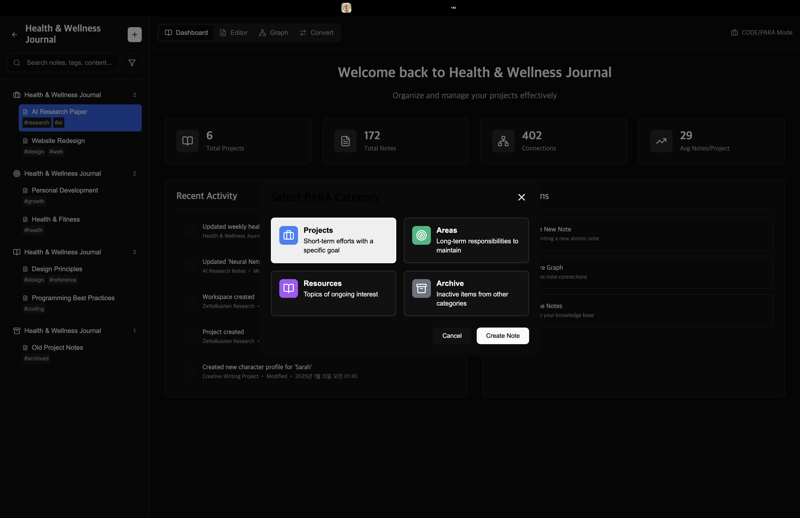

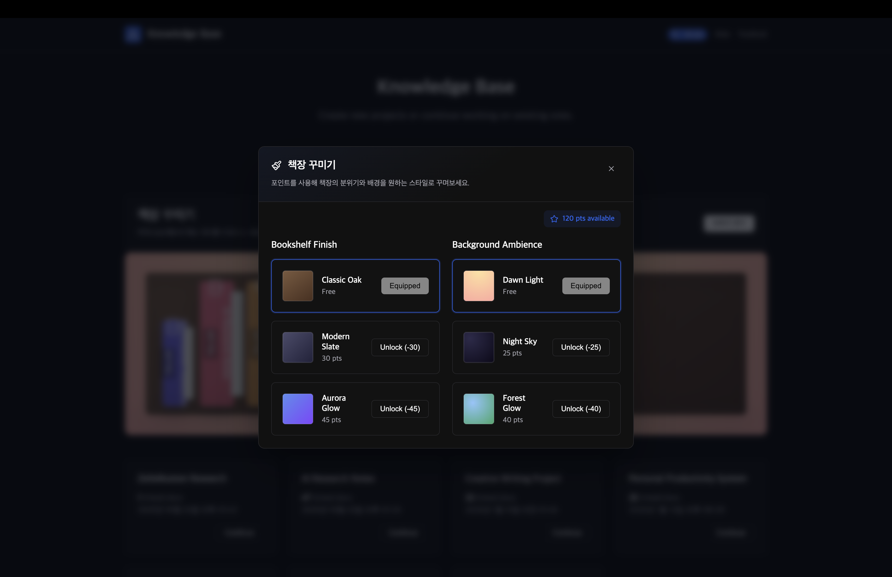

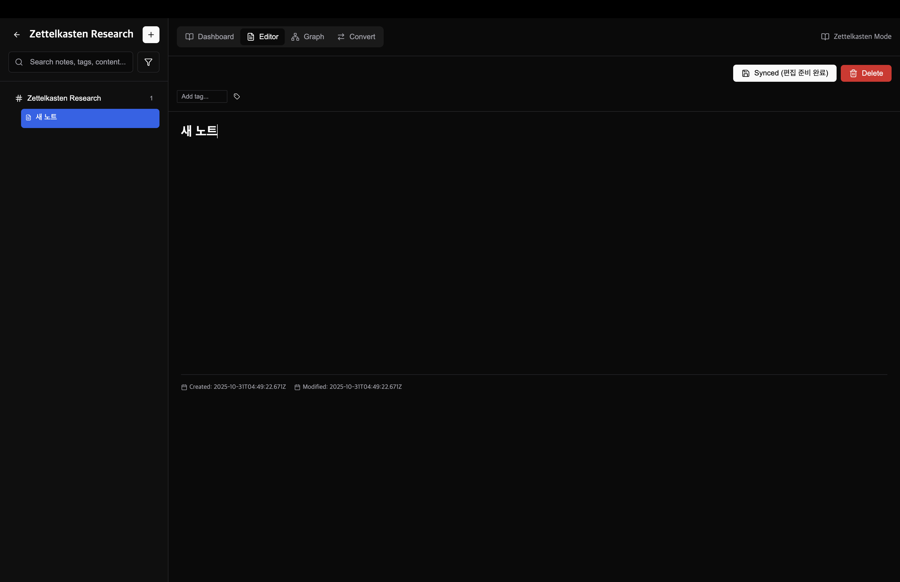